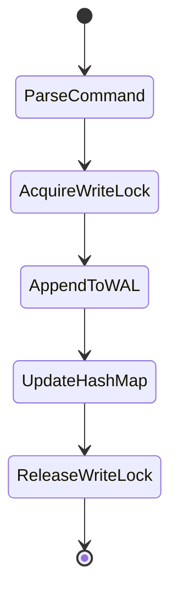
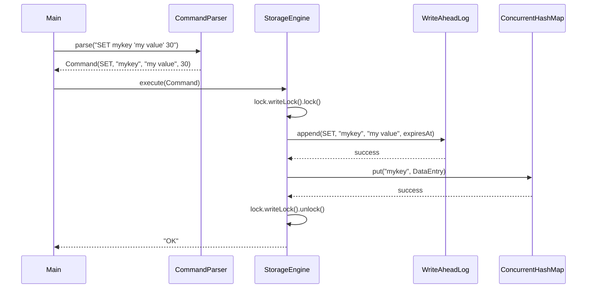
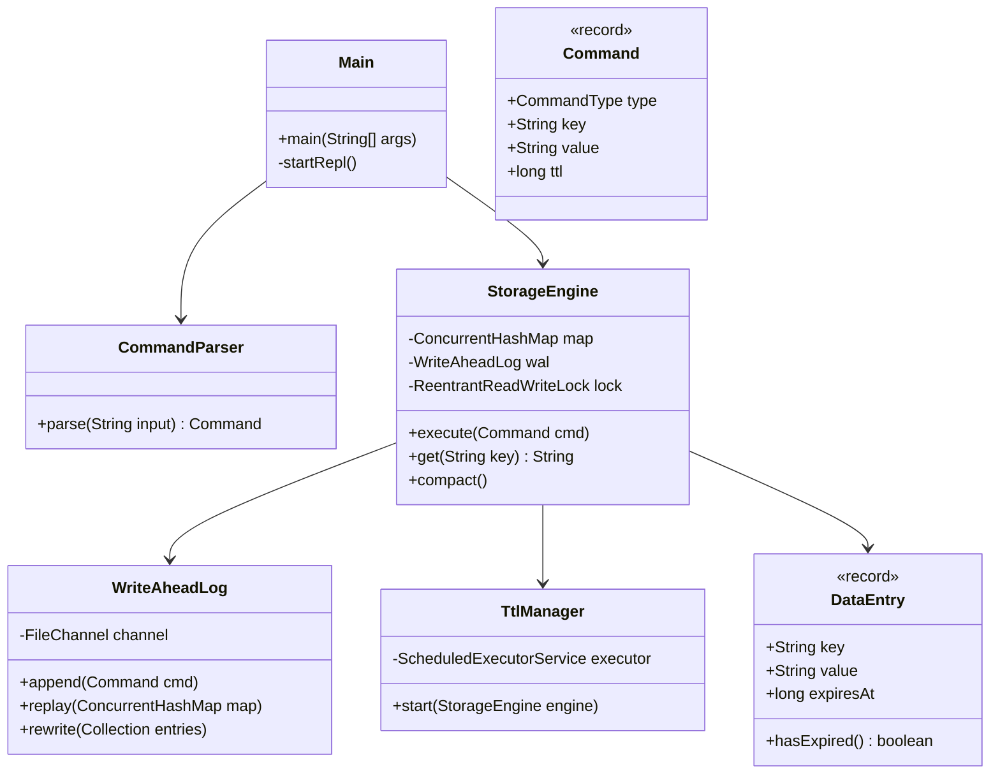

# KronoKV — In-Memory Key-Value Store with WAL

**Course:** Programming in Java  
**Date:** September 2026  

---

## 2. Introduction

For my final Java project, I decided to build KronoKV. Basically, it’s an in-memory key-value database, kind of inspired by Redis, but obviously way simpler. I wanted to see if I could write something that doesn't just store data in RAM and lose it when you hit Ctrl+C, but actually persists it to disk so you can recover it later. 

The idea here is to combine a super fast in-memory map with a Write-Ahead Log (WAL). Every time you add or change a key, it writes the command to a file on disk before it updates the memory. So if the app crashes, it can just replay that file on startup and get exactly back to where it was. I also added support for Time-To-Live (TTL), meaning you can set keys to automatically expire after a given number of seconds. 

Honestly, it sounded pretty straightforward when I pitched it, but dealing with file I/O, concurrent threads, and making sure the disk file doesn't grow infinitely huge turned out to be a massive headache. Still, I learned a lot building it, especially about concurrency in Java.

## 3. Problem Statement

Most standard Java collections like `HashMap` just live in memory. If you want to save data between runs, you usually have to write the whole map to a file or serialize it, which gets ridiculously slow if the map is big. On the other hand, writing to a real database like SQLite for every tiny operation felt like overkill for a lot of simple caching use cases.

So, the problem was: how do we build a lightweight, fast data store in Java that keeps data in memory for instant access, but still survives app restarts? And how do we handle expiring old data automatically so we don't run out of memory? I needed a middle ground—something that gives you the speed of a `HashMap` but the durability of disk storage, without being overly complicated to run.

## 4. Functional Requirements

I broke the project down into three main modules to keep things organized.

### Module 1: Memory Store
- **Basic CRUD:** Needs to support SET, GET, and DEL commands for keys and values. Values are just strings.
- **Key Expiration:** Users should be able to specify an optional TTL in seconds when setting a key.
- **Passive Expiration:** If someone tries to GET a key that has expired, the system should delete it right then and pretend it doesn't exist.
- **Active Expiration:** There needs to be a background thread (sweeper) that periodically wakes up and clears out expired keys so they don't sit in memory forever if nobody reads them.
- **Stats:** A STATS command to show how many keys are currently stored.

### Module 2: WAL Durability
- **Append-only Logging:** Every SET and DEL operation must be appended to a file on disk before the memory is updated.
- **Recovery:** On startup, the system needs to read the WAL line by line and replay all the commands to rebuild the in-memory map.
- **File Format:** The WAL should just be text, pipe-delimited, making it easy to parse.

### Module 3: REPL & Compaction
- **Interactive Shell:** A command-line interface where users can type commands and get responses back immediately.
- **WAL Compaction:** Since the WAL is append-only, if I update the same key 1000 times, the log gets huge. There needs to be a COMPACT command that rewrites the WAL to only include the current state of valid, unexpired keys, and then replaces the old file safely.

## 5. Non-Functional Requirements

- **Performance:** Reads (GET) need to be as fast as possible. Writes (SET/DEL) will be a bit slower because of disk I/O, but shouldn't block everything else forever.
- **Thread Safety:** Multiple clients or threads might be reading and writing at the same time, especially since the TTL sweeper is running in the background. Things shouldn't crash or get corrupted.
- **Fault Tolerance:** If the app crashes in the middle of a write, the log shouldn't be completely unreadable on the next startup.
- **Error Handling:** Bad commands from the user should be caught and print a helpful error message instead of throwing a stack trace.

## 6. System Architecture

Here is a rough sketch of how the pieces fit together:

```text
  [ Client / REPL ] 
         |
         v (Strings)
 [ CommandParser ] --> validates syntax, parses quotes
         |
         v (Command object)
 [ StorageEngine ] <-- ConcurrentHashMap (Memory)
         |      \ 
         |       \__ [ TtlManager ] (Background Daemon)
         v
 [ WriteAheadLog ] --> .wal file on disk (Append-only)
```

Basically, input comes in, gets parsed into a Command record, and then passed to the StorageEngine. The engine talks to the WAL to write to disk, and if that succeeds, it updates the `ConcurrentHashMap`. The `TtlManager` just runs in a loop, asking the engine to clear old stuff.

## 7. Design Diagrams

### Use Case Diagram

```mermaid
usecaseDiagram
    actor User
    actor BackgroundThread
    
    User --> (Set Key)
    User --> (Get Key)
    User --> (Delete Key)
    User --> (Run Compaction)
    User --> (View Stats)
    
    BackgroundThread --> (Sweep Expired Keys)
```

### Activity Diagram for SET



### Sequence Diagram for SET



### Class Diagram



## 8. Design Decisions & Rationale

I had to make a few hard choices while building this, mostly around concurrency and file handling.

**ReentrantReadWriteLock vs synchronized**  
At first, I just put `synchronized` on all the methods in `StorageEngine`. But that meant if a thread was doing a GET, it blocked everyone else. Since GETs should be fast and don't change anything (usually), I swapped to a `ReentrantReadWriteLock`. This way, multiple threads can read at the same time, but writes still get exclusive access. It made a huge difference in my multi-threaded tests.

**FileChannel vs FileOutputStream**  
For the WAL, I used Java NIO `FileChannel` instead of the old `FileOutputStream`. The reason was I needed to force the OS to flush data to disk (using `force(false)`, which syncs the file data without the metadata overhead) to make sure things weren't just sitting in the OS buffer cache. `FileChannel` gives you that control, and it felt faster for append-only workloads.

**Append-only vs In-place updates**  
Updating lines in the middle of a text file is a nightmare. If you change "cat" to "elephant", you have to shift all the bytes after it. So, I went with an append-only log. Every update just gets tacked onto the end of the file. To deal with the file getting too big, I implemented a compaction feature that just rewrites the whole thing from scratch when you tell it to.

**Why external lock with ConcurrentHashMap?**  
You might wonder, "if you're using `ConcurrentHashMap`, why do you need an external lock?" Turns out, the map is thread-safe on its own, but I have to do two things: write to the WAL *and* update the map. If two threads do this at the same time without an external lock, Thread A might write to the WAL, then Thread B writes to the WAL, then Thread B updates the map, then Thread A updates the map. The file and the memory would be completely out of sync. So the `ReentrantReadWriteLock` wraps both operations to make them atomic.

**Atomic move for compaction**  
When compacting the log, I didn't want to just delete the old file and write a new one, because if it crashed midway, you'd lose everything. I write all the current valid entries to a temporary file (`.wal.tmp`). Once it's completely written and flushed, I use `Files.move()` with `StandardCopyOption.ATOMIC_MOVE` to instantly replace the old WAL.

## 9. Implementation Details

I organized the code into a bunch of packages so it wouldn't just be one giant folder.

- **`com.kronokv`**: Just contains `Main.java`. This is the entry point. It sets up the REPL loop, prints the welcome banner, and handles the `Scanner` input.
- **`com.kronokv.model`**: Holds my data records. 
  - `DataEntry.java` is a Java record holding the key, the value, and the `expiresAt` timestamp. It has a nice `hasExpired()` helper method. 
  - `Command.java` is another record that holds the parsed command details, and `CommandType` is a simple enum (SET, GET, DEL, etc.).
- **`com.kronokv.engine`**: The brain of the operation.
  - `StorageEngine.java` handles all the logic. It owns the `ConcurrentHashMap` and the read/write locks.
  - `TtlManager.java` is just a daemon thread using a `ScheduledExecutorService` that calls a cleanup method on the engine every 5 seconds.
- **`com.kronokv.storage`**: Handles the disk stuff.
  - `WriteAheadLog.java` manages the file channel. It formats the data as `OP|KEY|VALUE|EXPIRES_AT` with a newline at the end. It also handles escaping pipes and newlines inside the values so parsing doesn't break.
- **`com.kronokv.parser`**: 
  - `CommandParser.java` takes the raw string from the user and tokenizes it. I had to write a custom parser here because simply calling `String.split(" ")` breaks if the user types `SET msg "hello world"`. I had to keep track of quote characters.
- **`com.kronokv.exception`**: Custom exceptions. `KronoException` is the base, then I have `CorruptedLogException` for when the WAL is garbage, and `InvalidCommandException` for bad syntax.

## 10. Screenshots & CLI Traces

Here is what it actually looks like when you run the project.

```text
+---------------------------------------+
|  KronoKV v1.0.0                       |
|  In-Memory Store with WAL             |
+---------------------------------------+

kronokv> SET mykey "this is a test"
OK
kronokv> GET mykey
this is a test
kronokv> SET temp "will vanish" 2
OK
kronokv> GET temp
will vanish
kronokv> STATS
Keys: 2 | WAL size: 68 bytes
```

(Waited 3 seconds...)

```text
kronokv> GET temp
(nil)
kronokv> STATS
Keys: 1 | WAL size: 68 bytes
kronokv> COMPACT
Compaction complete.
kronokv> STATS
Keys: 1 | WAL size: 38 bytes
```
As you can see, the WAL size dropped from 68 bytes down to 38 bytes after running compaction, because it threw away the entry for "temp" which had expired.

## 11. Testing Approach

I used JUnit for testing. Writing tests for the concurrency and file I/O parts was tough, but it saved me a bunch of times when I broke the parser.

| Test Class | Method | What it tests |
|---|---|---|
| **StorageEngineTest** | `testSetAndGet` | Basic insert and retrieve functionality. |
| | `testGetNonExistent` | Checking that it returns null or nil for missing keys. |
| | `testDeleteExisting` | Making sure DEL actually removes it from memory and log. |
| | `testDeleteNonExistent` | Ensure deleting a fake key doesn't crash. |
| | `testOverwriteValue` | SETting an existing key updates the value. |
| | `testListKeys` | Checks the KEYS command output. |
| | `testPassiveExpiration` | Sets a short TTL, Thread.sleep, then GETs it to see if it vanished. |
| | `testActiveExpiration` | Similar, but waits for the TtlManager to clean it up instead of calling GET. |
| | `testConcurrentWritesAndReads` | Spawns 10 threads doing 100 SETs each to make sure the locks work. |
| | `testCompaction` | Checks if `compact()` shrinks the WAL accurately. |
| | `testCrashRecovery` | Creates an engine, adds data, shuts it down, makes a new engine on the same file, checks if data is there. |
| | `testStats` | Checks if the output matches "Keys: X | WAL size: Y bytes". |
| **WriteAheadLogTest** | `testAppendAndReplay` | Raw test of writing to the file channel and reading it back. |
| | `testReplayWithDeletes` | Appends a SET, then a DEL, and makes sure the replay ends up with nothing. |
| | `testReplaySkipsExpiredEntries` | Replaying a file with old timestamps shouldn't put them in the map. |
| | `testCrashRecoveryPersistence` | Forces a channel close and reopens to test OS buffer flush. |
| | `testCompactionReducesFileSize` | Asserts file length is smaller after rewriting. |
| | `testReplayHandlesCorruptedLines` | Throws bad text into the file and makes sure it handles or skips it gracefully. |
| | `testSpecialCharactersInValues` | Checks if quotes, pipes, and newlines in values are escaped and unescaped correctly. |

## 12. Challenges Faced

I ran into a lot of weird bugs while making this.

**WAL+map atomicity:** Early on, my concurrent tests were failing. I realized I was locking around the map, and then locking around the WAL separately. This meant threads could interleave between the two locks. I had to wrap both operations in one massive lock block to fix it.

**ATOMIC_MOVE on Windows:** My `COMPACT` command worked fine on my Mac, but when I ran it on a Windows machine in the lab, `Files.move()` threw an exception. Turns out Windows gets really mad if you try to replace a file while you still have an open `FileChannel` to it. I had to completely close the old WAL channel, do the atomic move, and then open a new channel to the new file.

**TTL Races:** I had a bug where the sweeper thread would find an expired key, try to delete it, but in that exact millisecond, a user sent a SET command for the same key with a new value. The sweeper would accidentally delete the brand new value. I fixed this by checking the timestamp again right before actually deleting it inside the lock.

**Lock upgrade pattern in GET:** Passive expiration happens during a GET. I start with a read lock, check if the key is expired, and if it is, I need to delete it. But you can't delete with a read lock. You have to release the read lock, acquire a write lock, double-check if it's still expired (because another thread might have updated it while we were unlocked), and then delete. It felt super clunky to write but it works.

**Delimiter escaping:** My WAL uses pipes `|` to separate fields. The second I tried to store a value like `my|weird|string`, it broke the parser on recovery. I had to write custom logic to escape pipes as `\|` and unescape them when reading the log back.

## 13. Learnings & Takeaways

Honestly, building a database—even a tiny one—forces you to think about edge cases constantly. 

I learned that `ConcurrentHashMap` is awesome, but it doesn't solve all your threading problems if you have side effects (like writing to a file) that need to be synchronized with it. 

I also learned that file I/O in Java NIO is way more powerful than standard `java.io`, but also more punishing if you forget to flip a buffer or close a channel. Managing state on disk made me appreciate how much work goes into real databases like Postgres to keep things consistent when the power goes out.

## 14. Future Enhancements

If I had another month to work on this, here is what I would add:
- **TCP Server:** Right now it's just a local command-line app. Wrapping it in a simple socket server so I could connect to it over the network would make it much more useful.
- **Raft Consensus:** It would be cool to run three instances of KronoKV and have them sync with each other using Raft, so if one dies, the others keep going.
- **Compression:** The WAL is just raw text. Compressing the blocks before writing them to disk would save a ton of space.
- **Memory-Mapped Files (mmap):** Instead of manually reading and writing channels, mapping the WAL directly to memory could probably speed up reads and compactions.
- **Pub/Sub:** Adding channels where clients could subscribe to events (like when a key is updated or expires) would be a fun feature to build.

## 15. References
- Java Concurrency in Practice (Goetz) - Helped a lot with understanding ReadWriteLocks.
- Oracle Java NIO Documentation.
- Redis architecture blog posts (for inspiration on how passive/active TTL sweeping works).
